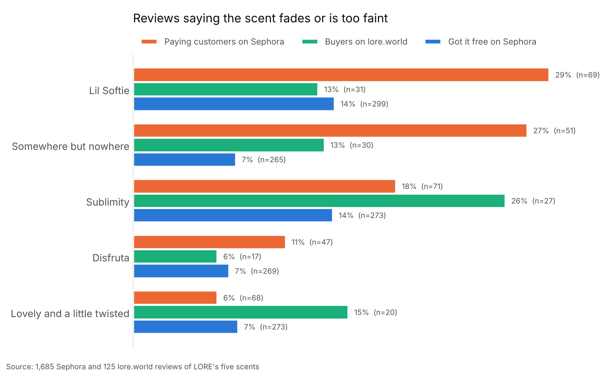

# What LORE's reviews say

Every public review of LORE's five fragrances, collected from Sephora, LORE's own site and
Fragrantica, then read in full and labeled to find the most common complaint.

**Main finding:** people who paid for a LORE scent mention that it fades or is too faint more
often than people who got it free (18% vs 10% of Sephora reviews). The gap is widest for
Lil Softie and Somewhere but nowhere. For the original four scents, paying reviewers' mentions
of fading rose from 11% of reviews before April 2026 to 21% since. Full numbers are in
[results.md](results.md).



## The data

| Source | Reviews | Dates | How it was collected |
|---|---|---|---|
| Sephora US | 1,760 unique, across 13 listings | Sep 5, 2025 to Oct 20, 2026 | Browser script reading the same review feed (Bazaarvoice) that Sephora's product pages load |
| lore.world | 154 | Oct 25, 2025 to Oct 20, 2026 | Browser script reading the same review feed (Yotpo) that LORE's product pages load |
| Fragrantica | 350 across 5 scents | Sep 12, 2025 to Oct 18, 2026 | Review text read from each scent's page; a cross-check, not part of the 1,914 |

- **Sephora.** Full-size and travel-size listings share one review pool for four of the scents,
  so reviews are de-duplicated by review ID. Everything is analyzed by scent; full-size and
  travel listings are pooled, and set listings covering several scents are left out of per-scent figures.
  Sephora marks reviews from people who received the product free ("incentivized"); 81% of
  LORE's reviews carry that mark or Sephora's disclosure line, including 532 of the 566 reviews
  posted in April 2026.
- **lore.world.** Every review is from a verified buyer and none are marked incentivized.
  The review widget groups reviews across related listings, so a review counts toward a scent
  only when it appears under exactly one scent; 29 reviews on sets are left unassigned.
- **Fragrantica.** An enthusiast community, generally harsher than retail shoppers.

## How the reviews were labeled and checked

1. **Every review read in full.** All 2,264 reviews were read and labeled for two things:
   whether the reviewer says the scent fades, is too faint, has weak projection or wishes it
   lasted longer (even in a 5-star review), and whether they compare it to cigarettes, an
   ashtray, barbecue or burnt rubber. These labels (`data/full_read_labels.csv`) drive every
   number in the article.
2. **Checked against the live sites.** Both Sephora and lore.world were pulled a second time on
   Oct 21, 2026 and compared review by review: every stored review matched its original on
   product, date, stars, gifted flag, title and full text, with none missing or extra.
3. **Keyword tags as a cross-check.** `analysis/code_reviews.py` also tags reviews by keyword.
   They agree with the full read on 94% of Sephora reviews for fading (99% for smoke), but miss
   milder complaints like "longevity is medium", so they undercount by a few points.
4. **Two robustness checks** (in results.md): the paid vs gifted gap holds within the same
   scent and quarter, and the rise over time holds without Lil Softie, which launched in
   2026 and makes up most recent reviews.
5. **A verification script** (`analysis/verify_reviews.py`) re-checks everything against a later
   snapshot of each site's own figures and writes a pass/fail report:
   - *Completeness:* every Sephora review pool, every lore.world listing and every Fragrantica page
     holds exactly as many reviews as the site says, with the same star breakdown and average.
   - *Accuracy:* every stored review matches the live site word for word, with the same stars,
     date, listing and gifted flag.
   - *Consistency:* gifted flag vs the review's own disclosure, scent named vs listing, stars vs
     wording, duplicate posts, and every label backed by a quote that actually appears in the review.
   - *Article:* every number quoted in the article reproduces from the data, plus sensitivity
     checks on the uncertain cases.

   Anything it can't confirm goes to a human review sheet, most consequential first (kept private, see below).

Decisions the checks led to, applied in code so they're traceable:
- Reviews carrying Sephora's own line "[I received this product in exchange for my honest
  review]" count as gifted even when the gifted flag is blank or "no" (31 reviews).
- Five labels whose supporting quote didn't appear in the review were corrected after re-reading
  (`data/label_corrections.csv`).
- Reviews are grouped by scent only. An earlier comparison of Lil Softie's travel and full-size
  listings was dropped: 90% of full-size reviews came from gifted reviewers, many of whom were sent a
  travel size, so the listings didn't separate buyers of each size.
- 121 Sephora reviews left the gifted question blank and count as paying; the paid vs gifted gap
  is larger, not smaller, without them.

The percentages describe what reviewers say, not every customer, and borderline cases (a
neutral "lasts about 4 hours") take judgment either way.

## Folder layout

```
collect/            browser console scripts that download the raw reviews
analysis/
  code_reviews.py                     attaches the full-read labels and the keyword tags
  make_results.py                     builds results.md and the charts
  verify_reviews.py                   cross-checks every review and number; writes the review list
  make_spot_check.py                  builds the sheet of every review for checking by hand
  fragrantica_first_pass_summaries.txt  an earlier summary-based coding, superseded by the full read
data/               coded reviews: dates, stars, gifted flag, labels, label corrections (no review text)
charts/             charts used in the article
results.md          every number in the article
```

## Reproduce it

1. **Collect** (needed first: the raw review text isn't in this repo, see below). In desktop Chrome, open a
   LORE product page on sephora.com, scroll to the reviews, open the console and paste
   `collect/collect_sephora.js`. Do the same on lore.world with `collect/collect_lore_world.js`.
   Move the two downloaded CSVs into a `private/` folder.
2. **Install** Python 3.10 or newer, then `pip install -r requirements.txt`.
3. **Run**, from this folder:
   ```
   python analysis/code_reviews.py
   python analysis/make_results.py
   python analysis/verify_reviews.py
   python analysis/make_spot_check.py
   ```
   This rewrites `data/`, `charts/`, `results.md`, the verification report and both review sheets.
   To re-verify later, rerun the two collect scripts and keep only the new `*_site_stats.json`
   files; the report then lists any reviews posted or removed since collection.

## Notes on private details

- Sephora's terms don't allow republishing reviewers' text, so the raw reviews, the verification
  files and the spot-check sheets have been intentionally left out. `data/` keeps every review's
  ID, date, stars, gifted flag and labels, so every number in `results.md` can be checked without them.
- The collection scripts read the review sites' public display keys from the page at run time,
  so no keys are stored in this repo.
- Reviewer names were never collected.
